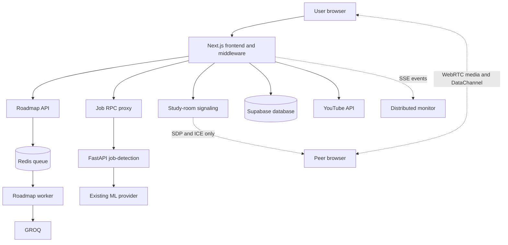

# DreamCanvas Distributed Systems Map

DreamCanvas keeps the original Next.js/Supabase application and adds small, observable distributed components suitable for a college demonstration.

## Architecture

## Syllabus mapping

| Topic | Working feature |
| --- | --- |
| Basics, client-server, three-tier | Browser, Next.js API/middleware, service/data tiers |
| Architectures and design issues | Service registry, bounded timeouts, retries, explicit failures |
| Middleware | Supabase session middleware and server-side API proxy boundary |
| Multimedia and virtualization | WebRTC audio/video and Docker Compose services |
| Computation model | SSE event monitor with Lamport-style logical ordering |
| RPC | Next.js `/api/job-detection` to FastAPI `/predict` |
| Message-oriented communication | Typed Redis `GENERATE_ROADMAP` messages and worker |
| Stream-oriented communication | SSE `/api/distributed-events` |
| P2P messaging | WebRTC `RTCDataChannel` chat messages |
| WebRTC | STUN-assisted offer/answer, ICE, camera and microphone tracks |
| Names, identifiers, addresses | `services` registry and UUID message/job/room IDs |
| Fault tolerance | Validation, health checks, retry, timeout, 502/503 responses, no fake ML result |

## Running

Copy `.env.example` to `.env.local`, install dependencies, start Redis, and run the app with `npm run dev`. To run the complete topology use `docker compose up --build`; Docker service names are used for internal addresses. The worker is required for the queued roadmap button, while the original synchronous roadmap button remains available.

Study Room uses the Next.js signaling endpoint only to exchange presence, SDP, and ICE setup messages. Once connected, chat uses `RTCDataChannel` and audio/video tracks flow peer-to-peer where the browser network permits it.

Names describe a service (`job-detection`), identifiers distinguish an instance or message (UUID `jobId`), and addresses locate it on a network (`http://job-detection:8000`).
