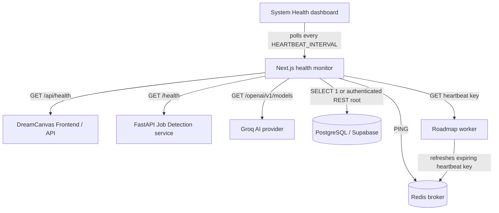

# DreamCanvas Health Monitoring

## Architecture

DreamCanvas has a Next.js frontend and API layer, a FastAPI job-detection proxy to the existing ML provider, Supabase/PostgreSQL, an optional Groq AI provider, and a Redis-backed roadmap worker. Redis and the worker are configured in Docker Compose; the worker does not currently have a Kubernetes deployment. Components that are not configured are reported as `UNKNOWN`, not marked healthy.

## Endpoints and checks

- `GET /api/health` reports the live Next.js process status, timestamp, response time, and process uptime.
- `GET /health` on the FastAPI job-detection service reports that service's own availability, timestamp, response time, and uptime. It does not claim the separate legacy prediction provider is healthy.
- `GET /api/system-health` runs concurrent checks against the configured frontend/API URL, FastAPI, Groq, PostgreSQL or Supabase REST, Redis, and the worker's Redis heartbeat. Health output contains operational status only; credentials and endpoint secrets are never returned.
- Groq is checked with its authenticated models endpoint; the key remains server-side. The database check uses `SELECT 1` when `DATABASE_URL` is configured, otherwise it checks the Supabase REST service with the anon key.
- The worker refreshes `dreamcanvas:health:worker` in Redis every heartbeat interval. The key expires if the worker stops refreshing it; the monitor validates the payload and lease age instead of displaying a seeded status.

The health dashboard polls `GET /api/system-health` rather than adding a new streaming dependency. Each dashboard poll is a heartbeat round, and individual probes have a timeout. The default state detector moves through `HEALTHY` → `DEGRADED` on the first failed round → `DOWN` after consecutive failures. A successful real probe clears the failure streak and emits a recovery event. `failureCount` is cumulative for the current monitor process.

## Configuration

| Variable | Default | Meaning |
| --- | ---: | --- |
| `HEARTBEAT_INTERVAL` | `10` | Dashboard and worker heartbeat interval in seconds |
| `HEARTBEAT_TIMEOUT` | `4` | Per-service probe timeout in seconds |
| `HEARTBEAT_FAILURE_THRESHOLD` | `2` | Consecutive failed probes before marking a service `DOWN` |
| `WORKER_HEARTBEAT_KEY` | `dreamcanvas:health:worker` | Redis key used by the roadmap worker and monitor |
| `HEALTH_DEMO_MODE` | disabled | May enable simulation explicitly in a production-mode demo deployment |

Invalid or non-positive timing values are ignored in favor of safe defaults. Docker Compose and the Kubernetes frontend ConfigMap set matching defaults.

## Beacon protocol and fault demonstration

The monitor sends periodic health requests (active heartbeats); the worker also sends a lease-renewing heartbeat to Redis. If a response misses its timeout or the worker lease expires, a failure is recorded. Independent checks mean that an unavailable AI, database, Redis, or worker does not crash the dashboard or prevent the other services from being checked.

The AI/ML card's **Simulate AI Service Failure** action is available only outside production or when `HEALTH_DEMO_MODE=true`. It changes only the monitor's local view and adds `TIMEOUT` → `DOWN` history events; it does not stop a process, alter Redis, or disrupt the real service. **Restore Service** removes the simulated override, after which the next probe determines the actual status.

Recent history and failure counters are held in the running Next.js process and are bounded to the latest 100 events. They are intentionally independent of the monitored database and Redis, so a Redis/database outage does not prevent the health UI from reporting it. In multi-instance deployments, history and demo overrides are instance-local; deploy a shared event store only if cross-instance history retention is required.

Job analysis already has a local heuristic fallback when the separate prediction service is unavailable. The monitor reports actual service availability and does not fabricate predictions or green states.

## Distributed-systems explanation

The Health Monitor periodically sends health checks/heartbeat requests to distributed services. If a service stops responding within the configured timeout, the service is marked as failed after the configured failure threshold. This demonstrates heartbeat-based failure detection and fault tolerance in a distributed system: failures are isolated and identified without bringing down the rest of DreamCanvas.
