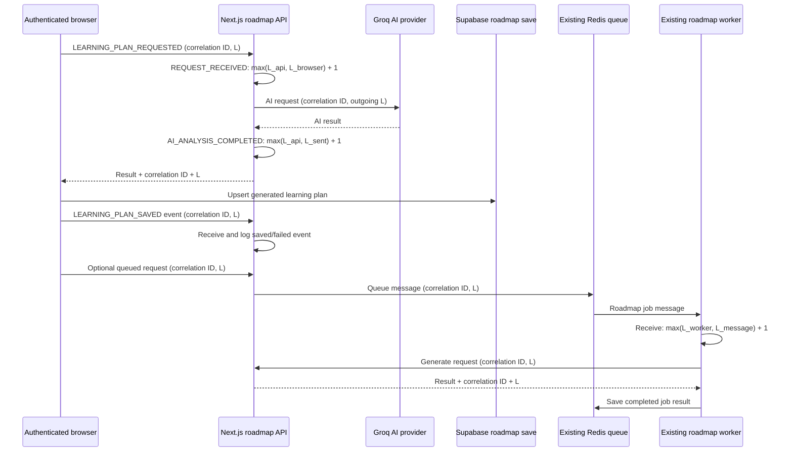

# Lamport Logical Clocks in DreamCanvas

## Existing workflow integrated

DreamCanvas generates plans through the Next.js `/api/generate-roadmap` route and the Groq AI provider, then saves a new plan from the authenticated roadmap page to Supabase. An optional Redis queue hands requests to the existing `roadmap-worker.mjs`, which calls that same generation route and stores the completed job in Redis. No additional service or database table is needed.

## Algorithm and process clocks

`LamportLogicalClock` is a reusable synchronous counter. A local event increments its process clock, a send increments and returns the timestamp placed on the outgoing message, and receive updates the clock to `max(local, received) + 1`. These synchronous state changes cannot interleave halfway through an increment in the JavaScript event loop, so overlapping requests cannot lose ticks.

The browser, Next.js API process, and roadmap worker keep separate logical clocks. The API stores independent clocks by process name rather than one application-wide counter. The worker uses its own counter in its separate Node process. The outgoing Groq request carries both `x-correlation-id` and `x-lamport-timestamp`; Groq is an external provider and does not promise to echo custom logical-clock headers, so the API applies the receive rule against the timestamp it sent. The logical values express causal ordering only; they do not synchronize clocks or establish that events with unrelated/equal timestamps are concurrent.

## Events and timeline

The actual workflow records `LEARNING_PLAN_REQUESTED`, `REQUEST_RECEIVED`, `AI_ANALYSIS_STARTED`, `AI_REQUEST_SENT`, `AI_ANALYSIS_COMPLETED`, `LEARNING_PLAN_RESPONSE_SENT`, and `LEARNING_PLAN_SAVED` or `LEARNING_PLAN_FAILED`. Optional queued requests also record worker receives, queue sends, and completed Redis job storage. The authenticated save-event endpoint is called only after the Supabase upsert succeeds; failures report `LEARNING_PLAN_FAILED`, never a successful save.

Events reuse the existing `distributed.ts` event logger and `/api/distributed-events` SSE feed. When Redis is configured, events are also kept in a bounded 500-event Redis list shared by Next.js instances, and Redis pub/sub streams live events from the API and separate worker. If Redis is unavailable, the API's bounded process-local history and SSE still operate; persistence is diagnostic runtime history, not a durable database audit log. This avoids adding a database schema or making the workflow depend on the database being available. Event records include request/correlation ID, process, event name, local/send/receive type, logical timestamp, physical recording time, status, and bounded error text. The timeline sorts by logical timestamp, then process name and event ID. This deterministic tie-breaker is display-only and does not imply causality.

## Demonstration

1. Sign in and open **AI Skill Gap Analyzer** (`/analyze`).
2. Select **Load DevOps Engineer Lamport-clock demo**. It fills a sample skills list and target role without bypassing normal submission.
3. Generate a roadmap (or use the optional Redis worker button if the worker and Redis are running).
4. Open **Lamport Clock Monitor** (`/distributed-monitor`) from the Profile menu. Filter by the request/correlation ID returned by the generation API, or view all events.
5. Follow events from the browser send to API receive, AI request/response, and the actual Supabase save. Use the process filter to compare each independent clock.

For a simple receiver example, start a receiver at `L=5`, deliver a message sent at `L=8`, and it advances to `L=9`. Automated tests exercise this rule and the real generation route using a mocked provider response; production requests are never assigned demonstration timestamps.
